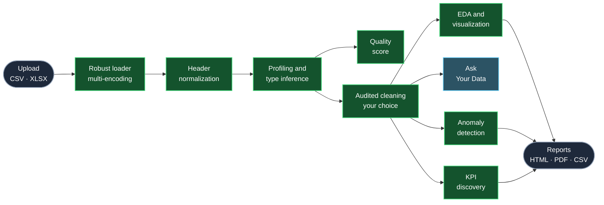
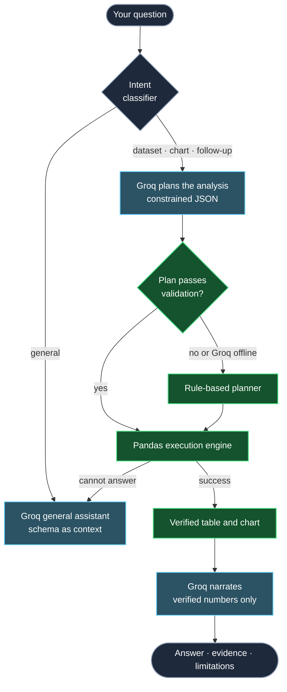
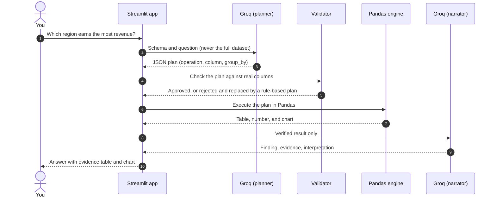

<div align="center">

# AI DATA ANALYSIS SYSTEM 
<p>
<i>A Streamlit platform that profiles, cleans, visualizes and answers questions about any CSV or Excel file —<br>
with a language model that does the math and all briliantly by itself.</i>
</p>

<a href="https://ai-data-analysis-system.streamlit.app/">

</a>

<br>

<b><a href="#the-problem">Problem</a></b> &nbsp;·&nbsp;
<b><a href="#the-idea">Idea</a></b> &nbsp;·&nbsp;
<b><a href="#architecture">Architecture</a></b> &nbsp;·&nbsp;
<b><a href="#feature-tour">Features</a></b> &nbsp;·&nbsp;
<b><a href="#under-the-hood">Under the Hood</a></b> &nbsp;·&nbsp;
<b><a href="#getting-started">Get Started</a></b> &nbsp;·&nbsp;
<b><a href="#privacy-what-leaves-your-machine">Privacy</a></b> &nbsp;·&nbsp;
<b><a href="#limitations-and-roadmap">Limitations</a></b>

<br>

<table>
<tr>
<td align="center" width="165"><h2>10</h2><sub>WORKSPACES</sub></td>
<td align="center" width="165"><h2>33</h2><sub>CHART TYPES</sub></td>
<td align="center" width="165"><h2>11</h2><sub>VERIFIED OPERATIONS</sub></td>
<td align="center" width="165"><h2>3</h2><sub>ANOMALY METHODS</sub></td>
<td align="center" width="165"><h2>0</h2><sub>DATASET FIGURES<br>COMPUTED BY AN LLM</sub></td>
</tr>
</table>

</div>

<br>

<div align="center">

<table>
<tr><td align="center">

<br>

<i>A good 60-second tour: **upload** any CSV or Excel file → open **Dashboard** to see the quality score and how it was calculated → ask **Ask Your Data** something like *"Which category has the highest total sales?"* and expand the evidence table to see the numbers behind the answer.<i>

> [!NOTE]
> The demo runs on Streamlit Community Cloud, so it may take a few seconds to wake up after a period of inactivity. Please avoid uploading confidential data to a public demo — see [Privacy](#privacy-what-leaves-your-machine).

<br>

</td></tr>
</table>

</div>


## The Problem

Working with real data tends to begin with friction, not insight. Six recurring frictions motivated this project:

| | The friction | Why it matters | How this project responds |
|:-:|---|---|---|
| **1** | **Real files are messy.** Mixed encodings, unnamed or duplicate headers, dates stored as text, numbers stored as strings. | Analysis stalls before it starts, and silent mis-parsing quietly skews results. | A multi-encoding loader, header normalization, and type inference with automatic date detection. |
| **2** | **"Is this data any good?" is answered by gut feeling.** | Decisions get built on weak data without anyone noticing. | A transparent 0–100 quality score in which every deduction is explained in plain language. |
| **3** | **Cleaning happens silently.** | Conclusions change and nobody can say why, or reproduce them. | The original is preserved, edits happen on a copy, and every step is timestamped and carried into reports. |
| **4** | **Answers need an analyst or code.** | Stakeholders wait, and simple questions queue up. | Ask in plain English and get a chart and an evidence table back. |
| **5** | **AI assistants can fabricate numbers.** | A fluent wrong answer is worse than no answer. | The model plans and narrates; deterministic Pandas does all of the calculation. |
| **6** | **Choosing the right chart is not obvious.** | Misleading or broken visuals, and time lost. | Scored chart recommendations, 33 chart types, and defensive data preparation behind each one. |

Built for analysts who want speed, and for stakeholders who want answers without waiting.

<br>

## The Idea

Most "chat with your data" tools hand a dataset to a language model and trust whatever comes back. That is quick to build and risky to rely on, because a model can produce a confident, well-formatted, completely wrong number.

This project starts from a different question:

> **What is the smallest role a language model can play while still making analytics feel effortless?**

The answer is a strict separation of concerns — the model is an **interpreter**, never the **accountant**.

| | Common approach | This project |
|---|---|---|
| **Who calculates** | The LLM, or code the LLM writes | A deterministic Pandas engine |
| **What the LLM produces** | Answers or executable code | A small JSON plan from a closed vocabulary |
| **Typical failure mode** | A confident, wrong number | A rejected plan that falls back to a rule-based planner |
| **Traceability** | Hard to inspect | The result table is shown with every analytical answer |
| **Without an API key** | Usually unusable | Profiling, cleaning, charts, anomalies, KPIs, and rule-based Q&A still work |

<br>

## Architecture

The color coding below is meaningful: **teal** nodes involve the language model, **green** nodes are deterministic code.

### From upload to report



### How a question is routed



<br>

## Anatomy of a Question

Here is what happens when someone asks, *"Which region earns the most revenue?"*



<div align="center"></div>

<div align="center"></div>

<div align="center"></div>

**Step 2 produces data, not prose.** The plan is a small JSON object, and the model must pick its `operation` from a closed set of eleven: `sum`, `mean`, `median`, `count`, `min`, `max`, `trend`, `correlation`, `distribution`, `top_n`, `summary`.

```json
{
  "operation": "top_n",
  "column": "revenue",
  "group_by": "region",
  "filters": [],
  "chart": "Horizontal bar",
  "limit": 10
}
```

**Step 8 is constrained too.** The narrator receives only the computed result, is told not to invent values or imply causation, and answers in a fixed structure:

```text
Finding          what the verified calculation shows
Evidence         rows analysed, filters applied, supporting table
Interpretation   what it means, without claiming causation
Recommendation   a practical next step
Limitations      what this result cannot tell you
```

**Follow-ups work.** The session remembers the last metric, category, and top entity, so *"what about its trend over time?"* becomes a filtered trend analysis on the entity just discussed.

<br>

## Feature Tour

Ten workspaces, one per stage of the analytical workflow.

| Workspace | What it does |
|---|---|
| **📊 Dashboard** | Dataset summary, quality score with a transparent breakdown, sample records, column overview |
| **🔍 Data Profiling** | Per-column statistics: missing values, cardinality, skewness, date ranges, invalid dates, top categories |
| **🧹 Data Cleaning** | Deduplication, imputation (mean, median, mode, custom), row dropping, type conversion, text standardisation — all logged |
| **📈 EDA** | Descriptive statistics, categorical frequencies, correlation heatmap, auto-generated observations |
| **💡 Recommendations** | Scored chart suggestions chosen from the shape of the data, each with a stated reason |
| **🎨 Visualization Explorer** | 33 chart types over any column combination, with PNG and HTML export |
| **💬 Ask Your Data** | Natural-language questions answered through verified calculations, with a general-purpose fallback |
| **🚨 Anomaly Detection** | IQR, Z-score, and Isolation Forest, with scored results |
| **🎯 Business KPIs** | KPIs inferred from column semantics, each shown with its formula and assumptions |
| **📄 Reports** | Downloadable cleaned CSV, HTML report, and PDF report |

<br>

## Under the Hood

### Guardrails against hallucination

| Guardrail | How it is enforced |
|---|---|
| **Closed vocabulary** | Plans with any operation outside the eleven allowed are discarded |
| **Schema grounding** | Every column in a plan is checked against the real dataframe |
| **No generated code** | The model returns data (JSON), never code, and nothing is passed to `eval` or `exec` |
| **Required-field checks** | Incomplete plans are rejected instead of guessed at |
| **Deterministic planning** | Plan extraction runs at temperature 0 |
| **Narration over evidence only** | The interpretation prompt receives computed results, not raw data to reason about |
| **Visible proof** | The supporting table is shown alongside every analytical answer |
| **Fallback path** | A rule-based planner ensures an invalid model response never silently becomes a wrong answer |

<details>
<summary><b>Data quality scoring</b> — the formula, in full</summary>

<br>

Every dataset receives a score out of 100. It is an app-specific transparency metric, not an industry standard, and the app says so. The formula is deliberately simple so every deduction can be explained.

| Signal | Penalty |
|---|---|
| Missing values | `missing ratio × 30` |
| Duplicate rows | `duplicate ratio × 20` |
| Constant columns | 3 points each (max 15) |
| High-cardinality categoricals (> 100 unique values) | 2 points each (max 10) |
| Numeric values stored as text | 4 points each (max 15) |

Scores of **85+** read *Good*, **65–84** read *Needs attention*, and anything lower reads *Poor*. Each deduction is listed in plain language, so the score explains itself.

</details>

<details>
<summary><b>Visualization engine</b> — recommendation, 33 chart types, and a safety layer</summary>

<br>

**Recommendation layer.** Inspects column types and cardinalities and scores candidate charts from 0 to 100 (a date column paired with a numeric one, for example, puts a line chart at the top). Each suggestion states why it was chosen.

**Universal builder.** One type-aware function supports 33 charts:

| Family | Charts |
|---|---|
| **Comparison** | Vertical bar, horizontal bar, grouped bar, stacked bar, 100% stacked bar, lollipop, Pareto, waterfall, funnel |
| **Trend** | Line, multi-line, area, stacked area, moving average |
| **Distribution** | Histogram, box, violin, density, ECDF, ridgeline-style, Q-Q plot |
| **Relationship** | Scatter, bubble, scatter matrix, correlation heatmap, categorical heatmap, residual plot |
| **Composition** | Pie, donut, treemap |
| **Specialised** | Anomaly plot, Gantt timeline, geographic map |

**Safety layer.** Real data is messy, so charts are prepared defensively before plotting:

- Date-like text is detected automatically (parsed when more than 75% of values convert)
- Numeric-looking text is coerced, and infinities become missing values
- Categorical charts are aggregated (sum, mean, median, count, min, max) instead of plotting raw rows
- Bubble sizes are normalised between the 5th and 95th percentiles, with negatives converted to magnitudes, so one extreme value cannot distort the chart
- Color and group fields are coerced to strings so Plotly never receives an incompatible type

</details>

<details>
<summary><b>Anomaly detection and KPI discovery</b></summary>

<br>

| Method | Approach |
|---|---|
| **IQR** | Flags values beyond 1.5× the interquartile range |
| **Z-score** | Flags values beyond an adjustable threshold |
| **Isolation Forest** | Unsupervised tree-based detector (5% contamination, fixed seed for reproducibility) |

Results are framed as statistical deviations, not errors — an anomaly may be a data problem, a rare event, or the most important row in the file.

**KPI discovery** looks for semantically meaningful columns (revenue, profit, cost, quantity, customer, order, date) and, when the right combination exists, computes total and average revenue, value per unit, gross margin, profit margin, orders per customer, and date coverage. **Every KPI is shown with its formula and its assumption**, because a metric without a definition is just a number.

</details>

<details>
<summary><b>Ingestion and audit trail</b></summary>

<br>

- **Robust loading** — CSVs are attempted as UTF-8, UTF-8 with BOM, Latin-1, and CP1252, with malformed lines skipped; Excel `.xlsx` and `.xls` are supported
- **Header normalization** — blank, unnamed, and duplicate column names are repaired and each repair is logged
- **Original preserved** — uploads are never modified; every transformation is applied to a working copy
- **Timestamped log** — each cleaning action records what changed and the before and after counts, and the log appears in the exported reports
- **Per-feature degradation** — SciPy, scikit-learn, ReportLab, and the Groq client are imported defensively, so a missing library disables only the feature that needs it

</details>

<br>

## Tech Stack

<div align="center">


</div>

<br>

| Layer | Technology | Role |
|---|---|---|
| Application | Streamlit | Interface, session state, file handling |
| Data processing | Pandas, NumPy | Every calculation, filter, and aggregation |
| Statistics | SciPy, scikit-learn | Q-Q plots and Isolation Forest (both optional) |
| Visualization | Plotly | Interactive charts and exports |
| Language model | Groq API | Plan extraction and narration, with models listed dynamically from your account |
| Reporting | ReportLab, HTML | PDF and HTML exports (ReportLab optional) |
| Configuration | python-dotenv, Streamlit secrets | Keeping the API key out of the source |

<br>

## Getting Started

```bash
# 1. Clone the repository
git clone https://github.com/<your-username>/<your-repo>.git
cd <your-repo>

# 2. Create and activate a virtual environment
python -m venv venv
source venv/bin/activate        # Windows: venv\Scripts\activate

# 3. Install dependencies
pip install -r requirements.txt

# 4. Add your Groq API key (see below)

# 5. Launch
streamlit run ai_data.py
```

The app opens at `http://localhost:8501`. Upload a CSV or Excel file from the sidebar to begin. The repository also ships with a `.devcontainer` configuration, so it can be opened in a VS Code Dev Container or GitHub Codespaces without local setup.

### Configuration

**Local** — create a `.env` file in the project root:

```env
GROQ_API_KEY=your_groq_api_key_here
```

**Streamlit Community Cloud** — add it under *Settings → Secrets*:

```toml
GROQ_API_KEY = "your_groq_api_key_here"
```

Once a key is present, the sidebar lists the models available to it and offers a one-click connection test.

> [!TIP]
> No key? The app still runs. Profiling, cleaning, EDA, all 33 charts, anomaly detection, KPI discovery, rule-based question answering, and reports work without Groq. Only AI-written interpretations and general-knowledge answers need it.

> [!IMPORTANT]
> Keep `.env` out of version control. Excel support needs `openpyxl` (`.xlsx`) and `xlrd` (`.xls`), PNG chart export needs `kaleido`, and the map chart needs a recent version of Plotly — make sure those are in `requirements.txt` if you use those features.

<br>

## Project Structure

```text
├── .devcontainer/      Dev Container configuration
├── .gitignore
├── ai_data.py          The complete application
├── requirements.txt
└── README.md
```

Inside `ai_data.py` the code is arranged in clear layers: configuration and styling → session state → loading and validation → profiling and quality scoring → cleaning → chart preparation and construction → analytical execution engine → Groq integration → KPI discovery → report generation → Streamlit interface.

<br>

## Design Decisions

| Decision | Alternative considered | Why this way |
|---|---|---|
| **A closed set of operations** | Letting the model write Pandas code | Testable, validatable, and safe to run against user data |
| **A rule-based fallback** | Failing when the model fails | Model errors degrade features, never correctness |
| **Original data untouched, every step logged** | Editing in place | Cleaning silently changes conclusions; an audit trail keeps them explainable |
| **Visible quality-score arithmetic** | One opaque number | Trust requires being able to disagree with the formula |
| **A constrained narrator** | Free-form commentary | Hallucination can enter at the explanation stage too |
| **Defensive optional imports** | Hard dependencies | Degrade per feature instead of crashing on import |

<br>

## Privacy: What Leaves Your Machine

Every calculation runs locally. When Groq is enabled, limited information is sent to its API:

| Stage | What is sent |
|---|---|
| Analysis planning | Column names, inferred types, cardinality, and up to five sample values per column |
| Interpretation | The computed result (aggregates, not raw rows) and the question |
| General questions with a dataset loaded | Column names, type groupings, and the first three rows |

The full dataset is never transmitted.

> [!WARNING]
> Sample values and rows *do* leave the machine when Groq features are used. Do not use them with confidential or regulated data unless you are comfortable with that. Without an API key, nothing is sent anywhere.

<br>

## Limitations and Roadmap

### Known limits

- **In-memory processing** — the whole dataset lives in memory in a single-user session; files above roughly 500,000 rows trigger a warning and may run slowly
- **Keyword-based intent routing** — ambiguous phrasing can send a question down the wrong path (it fails gracefully, but not always optimally)
- **Closed analytical vocabulary** — eleven operations cover common cases, not multi-step reasoning, joins across tables, or multi-metric comparisons
- **Minimal filter support** — filters arrive mainly through conversational follow-ups rather than arbitrary conditions extracted from a question
- **Univariate anomaly detection** — each method inspects one numeric column at a time and cannot catch anomalies that only appear across combinations of fields
- **General answers do not compute** — when a question falls through to the general assistant, the model sees the schema but performs no calculation, so read its reply as guidance
- **Narration is constrained, not formally verified** — it is grounded in computed results, but treat it as a draft to review

### What's next

- [ ] **Evaluation harness** — benchmark question-to-plan accuracy across datasets, so planner reliability is measured rather than assumed
- [ ] **Embedding-based intent routing** to replace keyword matching
- [ ] **Multi-step planning** with tool calling for questions that need chained analyses
- [ ] **Multi-table support** with joins and relationship detection
- [ ] **Multivariate anomaly detection** across feature combinations
- [ ] **Persistent sessions** so cleaning history and chat survive a refresh
- [ ] **Automated tests** for the execution engine and plan validator
- [ ] **Local model option** for fully offline, privacy-preserving use

<br>

<div align="center">


<br>

**Built by Armaan Srivastava**

<a href="https://www.linkedin.com/in/armaan-srivastava-7a6122286">

</a>
<a href="mailto:armaansrivastava321@gmail.com">

</a>

<br>

<sub>Built on one simple belief: AI is most useful in analytics when it is trusted for judgment and never for arithmetic.</sub>


</div>
